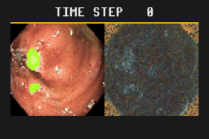

# Binary Segmentation: KvasirSeg

Train and evaluate NCAs on a medical dataset for endoscopic colorectal polyp segmentation.
The dataset is rather small (1000 samples) and heterogeneous, which poses an additional challenge and requires robust models.




## Training

```bash
uv run tasks/segmentation/kvasir_seg/train_segmentation_kvasir_seg.py
```

## Evaluation

The evaluation script generates an animated gif, showing the segmentation mask and hidden channels side-by-side.

```bash
uv run tasks/segmentation/kvasir_seg/eval_segmentation_kvasir_seg.py
```


## Dataset

Please note that, according to the terms of use described on [the Kvasir SEG webpage](https://datasets.simula.no/kvasir-seg/), commercial use of this dataset is forbidden.
